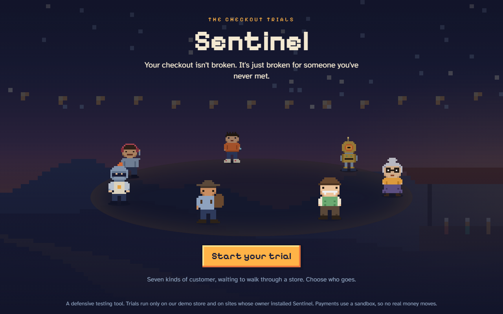
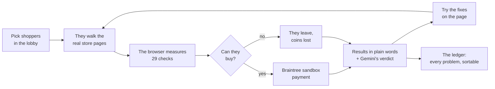
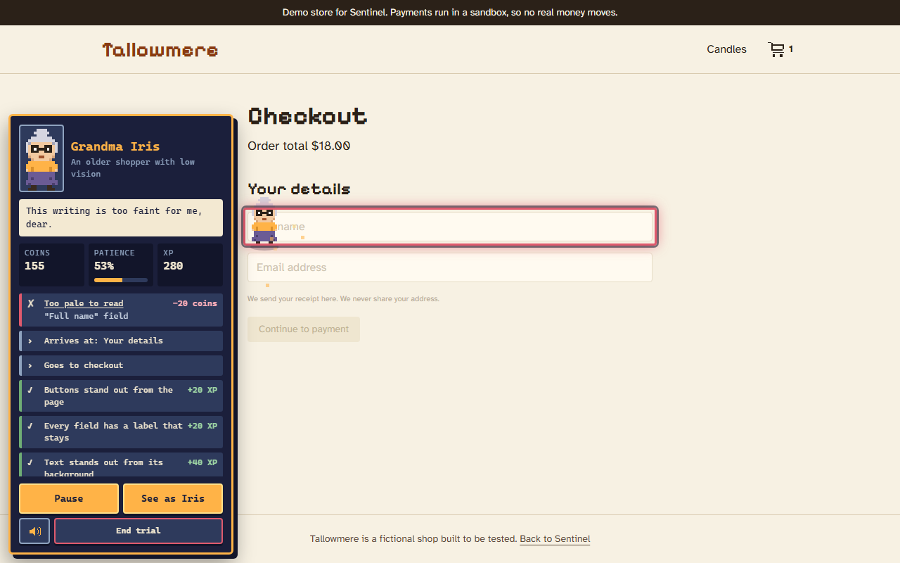
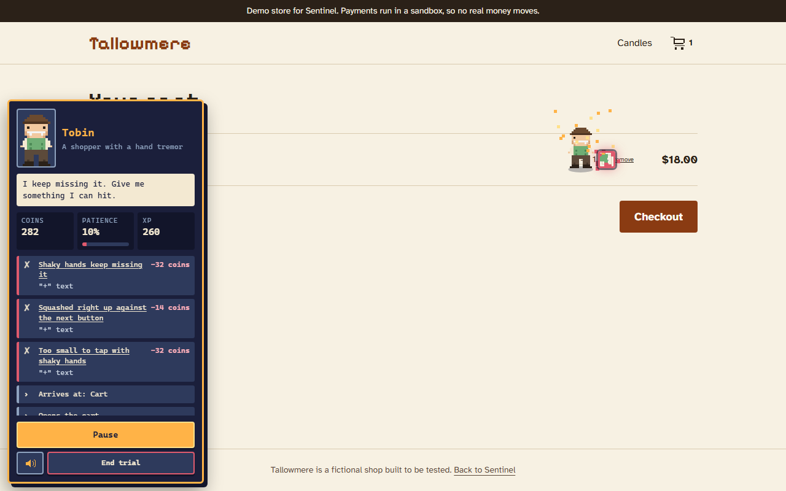
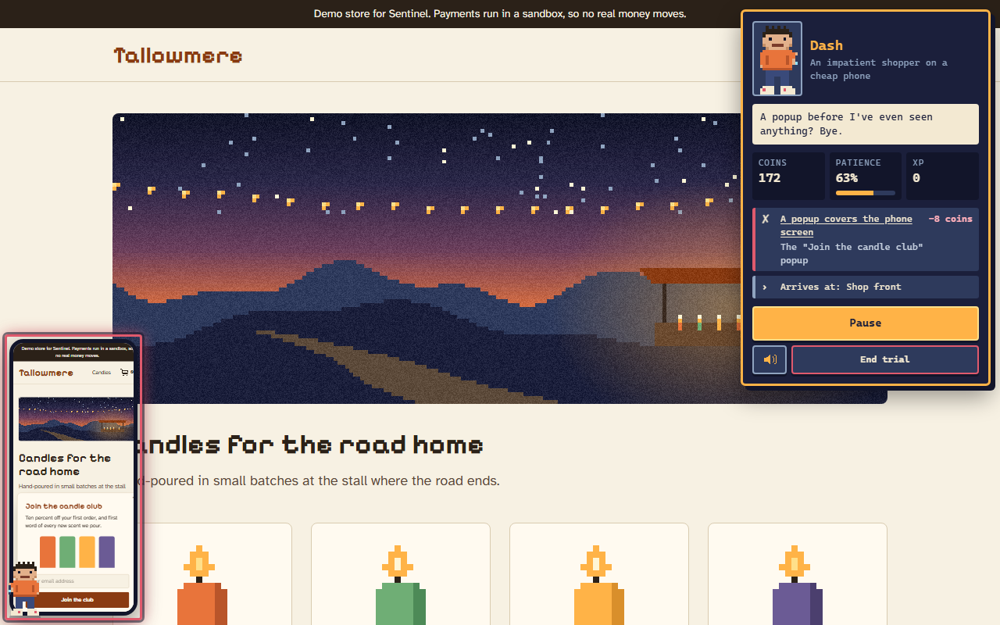
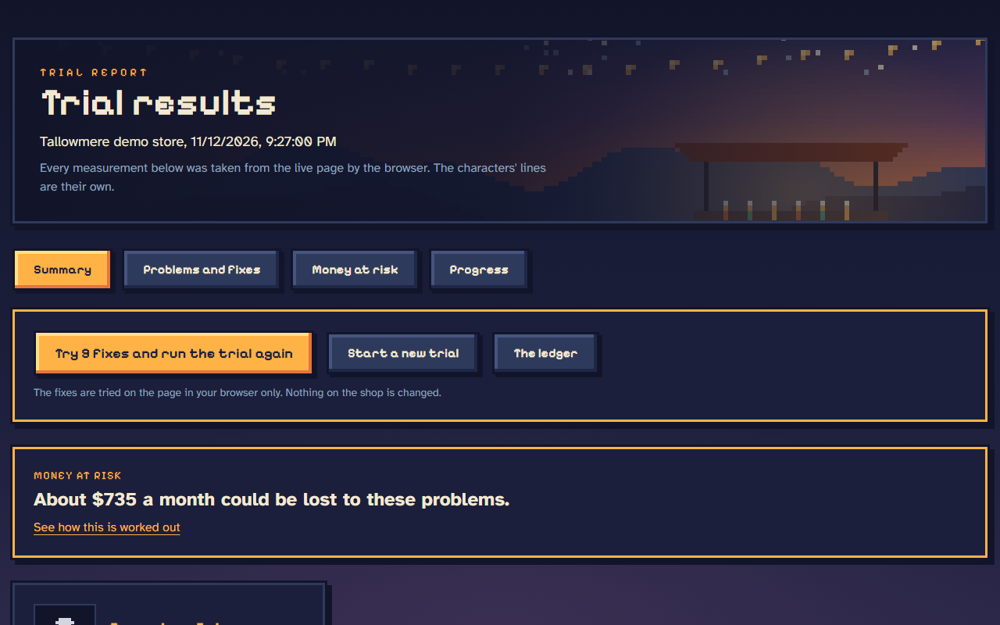
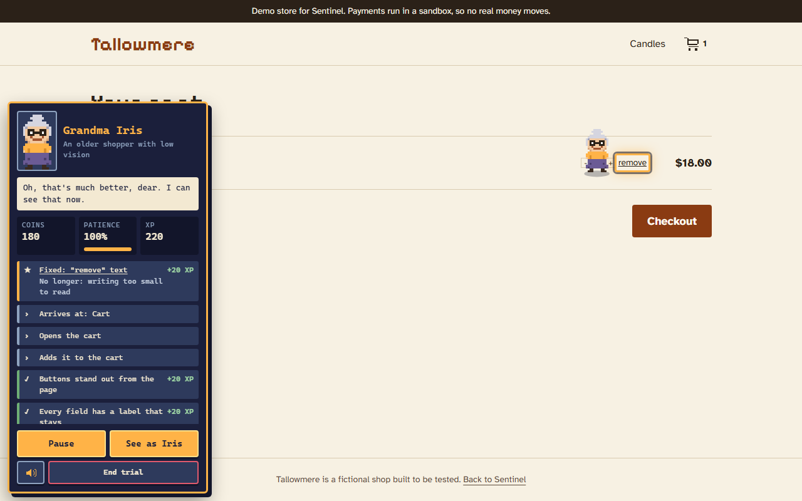
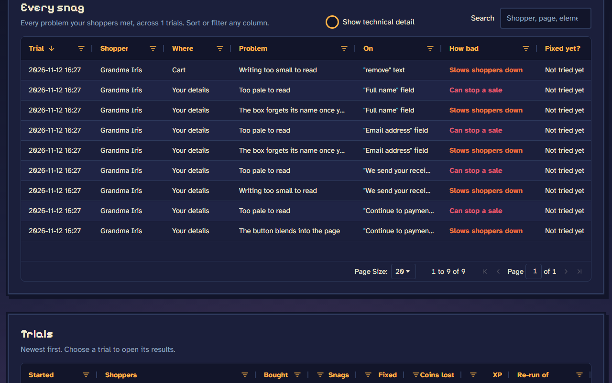

# Sentinel: The Checkout Trials

> Your checkout isn't broken. It's just broken for someone you've never met.

Sentinel is gamified accessibility testing for websites and checkouts. Seven pixel-art shoppers,
each standing for a real kind of customer, walk through a store's actual pages and try to buy
something. You watch where
each one struggles, see what it could cost you, try the fix in one click, and send them again.

**[Try it live](https://sentinel-ten-ashy.vercel.app)** · **Demo video** (link coming) ·
**[Slides](deck/)** · Built for the PayPal AI Hackathon · MIT licence



## Why

Shops get built on fast laptops by people with steady hands and good eyes. Shoppers who don't
fit that don't complain. They just leave, and the owner only sees a lower number, never why.
Accessibility reports exist, but they're long, technical and easy to put off. Sentinel shows
the problem as it happens instead: a person you can picture, stuck on your page, losing patience
and coins until the sale is gone.

## How a trial works



1. **Pick who goes.** Seven shoppers stand in the lobby. Tick the ones you want.
2. **Watch them walk.** Each one walks through the store: home, product, cart, details and
   payment. They check each page the way that customer would, and react when something gets
   in the way.
3. **Every problem costs them.** A problem takes coins from their purse and patience from their
   bar. Run out of patience, and the shopper leaves without buying.
4. **Read the results.** Who bought, who left, and where. The worst problems come first, in
   plain words, with an estimate of the money at risk each month.
5. **Fix it and run again.** Every problem comes with a fix, shown as code. Try them all on the
   page in one click, send the same shoppers back, and compare before and after.



## The shoppers

| Shopper      | Stands for                            | Checks                                                                   |
| ------------ | ------------------------------------- | ------------------------------------------------------------------------ |
| Grandma Iris | An older shopper with low vision      | Text contrast, text size, labels that vanish, buttons that blend in      |
| Tobin        | A shopper with a hand tremor          | Target size, spacing, risky neighbours, 20 simulated shaky taps          |
| Pell         | A shopper on a slow rural connection  | Page weight, wait time on a slow line, oversized images, layout shift    |
| Knock        | A shopper who uses only a keyboard    | Reachability, a visible focus, tab order, a skip link                    |
| Echo         | A shopper who uses a screen reader    | Image descriptions, control names, headings, landmarks, page language    |
| Dash         | An impatient shopper on a cheap phone | Sideways scrolling, phone set-up, popups that cover the screen, autofill |
| Cog          | An AI shopping agent                  | Machine-readable product data, matching prices, real buttons             |

That's 29 checks. Every number is measured by the browser on the live page: contrast ratios,
sizes in pixels, bytes downloaded, focus order. The AI never makes up a measurement.

| Tobin's shaky taps: red ones missed                                                      | Dash's phone: a popup covers the screen                                               |
| ---------------------------------------------------------------------------------------- | ------------------------------------------------------------------------------------- |
|  |  |

## Results, fixes and the ledger



- **Summary:** each shopper's outcome, their worst problems in plain words, and the money at risk.
- **Problems and fixes:** every problem with its measurement, why it matters, and a fix as CSS or
  HTML. Gemini writes a verdict for each shopper from the measurements.
- **Money at risk:** a stated, adjustable estimate of what the problems could cost each month,
  with every assumption shown.
- **Progress:** XP, store levels and achievements, so fixing your shop feels like levelling up.

After the fixes, the same shoppers walk again. In our demo store, Grandma Iris goes from
9 problems and a lost sale to none, keeps all 180 coins and pays through the sandbox.



**The ledger** keeps every problem from every trial in one table built with
[AG Grid](https://www.ag-grid.com/). You can sort and filter it, search it, and see what's fixed.
Plain columns show by default, and the technical detail is one switch away.



## How PayPal and AI are used

**Braintree sandbox (a PayPal service)** runs the demo store's real checkout:

- Orders with line items, with prices worked out on the server and never trusted from the browser.
- Declines are handled, and double payments are blocked (each order has its own ID).
- Webhooks are checked for a valid signature.
- People pay through Braintree's Drop-in UI. The shoppers press the store's sandbox test card
  button, so a trial ends in a real sandbox payment or a real failure.

**Gemini** does the parts that need judgement:

- Writes each shopper's verdict from the measurements, and says so on screen. The numbers stay
  the browser's.
- Suggests colours for contrast fixes. A suggestion is only used if it passes the contrast maths.
- Runs **Cog's agent.** Cog reads the product data, its agent decides whether the price and item
  are right, and if so, the server places a sandbox order with no one pressing Pay. This is
  agentic commerce, tested the same way as every other shopper. If the store's product data
  can't be read, Cog can't buy.

If Gemini can't be reached, Sentinel uses its own built-in notes and says so.

## Who it's for

- **A small shop owner,** before opening the doors: send all seven shoppers before your first
  customer does.
- **An agency or freelancer,** handing over a client's shop: paste one line into the client's
  site, and hand over a clear list of problems and fixes.
- **A developer,** before every release: try the fixes in seconds, and run the same shoppers again.

## Try it on your own site

On the [own-site page](https://sentinel-ten-ashy.vercel.app/sites), enter your site's address to
get one line of code. Paste it into your pages. For ordinary visitors it does nothing: no
requests, no storage, no changes to the page. When you start a trial from Sentinel, the shoppers
visit your site and **only look**: they never type, click Pay or buy anything there.

This version works on public pages without a login.

## Safety

Sentinel is a defensive testing tool, and its limits are enforced in code:

- **It only runs where it's allowed.** Trials run only on our demo store and on sites whose owner
  installed the line of code, using a signed key (`lib/guards/allow-list.ts`, `lib/trial/sites.ts`).
- **It only uses the sandbox.** A live payments setting makes the app refuse to start
  (`lib/guards/sandbox.ts`). No real money moves.
- **It never probes anything.** There are no scans, attacks or password guessing, and it never
  touches PayPal's own systems.
- **Fixes are allow-listed.** Only fixes on a fixed list can be tried on a page.
- **Records stay with you.** Trial records are kept in your own browser.

## Try the demo store yourself

Open [the store](https://sentinel-ten-ashy.vercel.app/store) and buy a candle. Payments use the
Braintree sandbox, so use a test card: **4111 1111 1111 1111**, any future expiry date, any CVV.

## Where it's going

- **Whole journeys, not just checkout:** sign-up, search, booking and account pages, on websites
  and in apps.
- **More kinds of people:** colour blindness, dyslexia, memory and attention, older devices, a
  phone in bright sunlight.
- **Research data at scale:** as AI gets closer to simulating real people, it will need to
  simulate disability and other limits too. Simulated access needs could produce large,
  repeatable sets of test data on how people use software, to speed up accessibility research
  and product development. Very little work has been done here yet.
- **Safety as well as access:** security checks the owner switches on, which find common
  weaknesses and suggest fixes. They'll run under the same rules as today.
- **Easier, safe connection:** a simpler way to link a site or app, with the same promise: it only
  runs where you put it, and your customers' data stays untouched.
- **A simply priced product** that takes you through your site or app and makes sure it meets a
  clear standard of accessibility and safety.

It doesn't replace testing with disabled people. It catches the measurable problems early, so
those sessions go further.

## Run it locally

Requires Node.js 22 or later.

```bash
npm install
cp .env.example .env.local   # then fill in the values
npm run dev
```

Open http://localhost:3000. You'll need Braintree sandbox keys
([sandbox.braintreegateway.com](https://sandbox.braintreegateway.com)). A Gemini key is optional:
without one, Sentinel uses its built-in notes.

## Tests

```bash
npm run check          # lint, type checks and 100 unit tests
npm run build && npm run e2e   # 24 browser tests that walk real trials end to end
```

## Built with

Next.js 16, React 19, TypeScript and Tailwind CSS · Braintree (PayPal) sandbox and Drop-in UI ·
Google Gemini · AG Grid Community · jose for signed trial keys · esbuild for the trial engine ·
Playwright and Vitest for tests · Pixelify Sans and Atkinson Hyperlegible fonts. The pixel art,
sprites and sounds are drawn and generated in code.

## Licence

[MIT](LICENSE)
